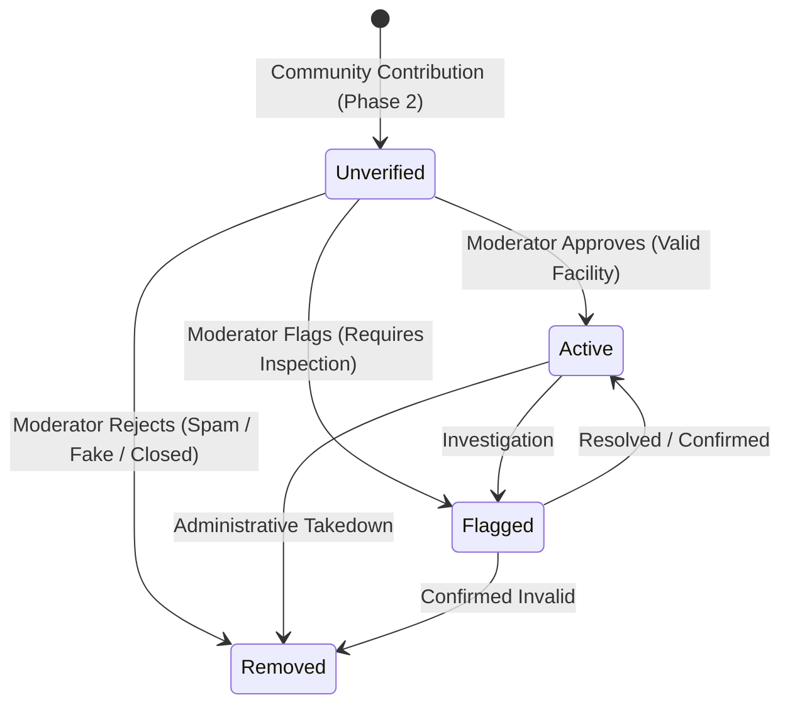

# P4.0 — Moderation & Facility Operations Specification

**Milestone:** Phase 4 / P4.0  
**Status:** SPECIFIED — READY FOR OWNER REVIEW  
**Development Sequence:** Phase 2 (P2.5 closeout + P2.6 gate) → **Phase 4 (Moderation)** → Phase 3 (Ratings/Reporting) → Phase 5  
**Parent Documentation:** `docs/01-architecture.md`, `docs/02-data-model.md`, `docs/03-privacy-security.md`

---

## 1. Authority & Strategic Intent

Read `AGENTS.md`, `docs/STATUS.md`, `docs/README.md`, `docs/02-data-model.md`, and `docs/03-privacy-security.md`.

### Strategic Justification for Accelerating Phase 4
Phase 2 opens community contributions of restrooms into Cloud Firestore as `status: 'unverified'`. Without operational moderation:
1. Contributed facilities accumulate in `unverified` state with no trusted path to `status: 'active'`.
2. Public maps risk clutter from low-quality or inaccurate submissions.
3. Introducing community ratings and user reports (Phase 3) on unmoderated facilities creates compounding data integrity risks.

Accelerating **Phase 4 (Moderation & Facility Operations)** directly after Phase 2 establishes a trusted administrative lifecycle for base restroom listings before enabling user ratings and reporting workflows.

### Bounded Scope:
- **IN SCOPE:** Operational moderation of community-contributed restrooms and their corresponding private contribution records.
- **EXPLICITLY DEFERRED (Phase 3):** User rating submissions, one-rating-per-UID ownership records, user verification events, and user report submission forms.

---

## 2. Privileged Service Boundary Architecture

### 2.1 Preserving Client Security Invariants
In `firestore.rules`, public restroom documents and private contributions are strictly create-only for mobile clients:
```javascript
match /restrooms/{restroomId} {
  allow read: if true;
  allow create: if isAuthenticated() && ...;
  allow update: if false;  // LOCKED INVARIANT
  allow delete: if false;  // LOCKED INVARIANT
}

match /contributions/{contributionId} {
  allow read: if isAuthenticated() && resource.data.userUid == request.auth.uid;
  allow create: if isAuthenticated() && ...;
  allow update, delete: if false;  // LOCKED INVARIANT
}
```

**Mobile clients must NEVER be granted direct update or delete permissions in Security Rules.**

### 2.2 Privileged Backend Boundary
All status transitions and moderation mutations are executed exclusively through a **privileged server boundary** using the Firebase Admin SDK:
- **Cloud Functions V2 Callable Function:** `moderateRestroom`
- **Authentication & Authorization:** Enforced via Firebase Auth Custom Claims (`token.admin === true` or `token.moderator === true`).
- **Data Integrity:** Admin SDK bypasses client Security Rules, ensuring client rules remain strictly create-only without opening update attack surfaces.

---

## 3. Restroom Moderation Lifecycle & State Machine



### 3.1 State Transitions
When a moderator acts on a contribution, the server boundary executes an atomic batch update across three documents:

1. **Public Restroom Record (`/restrooms/{restroomId}`):**
   - Approve: `status = 'active'`, `updatedAt = serverTimestamp()`
   - Reject: `status = 'removed'`, `updatedAt = serverTimestamp()`
   - Flag: `status = 'flagged'`, `updatedAt = serverTimestamp()`
2. **Private Contribution Record (`/contributions/restroom_{restroomId}`):**
   - Approve: `moderationState = 'approved'`, `updatedAt = serverTimestamp()`, `moderatedAt = serverTimestamp()`, `moderatorUid = context.auth.uid`
   - Reject: `moderationState = 'rejected'`, `updatedAt = serverTimestamp()`, `moderatedAt = serverTimestamp()`, `moderatorUid = context.auth.uid`
   - Flag: `moderationState = 'flagged'`, `updatedAt = serverTimestamp()`
3. **Immutable Audit Log (`/moderationAuditLogs/{logId}`):**
   - Automatically generated document recording the full audit trail.

### 3.2 Audit Log Schema (`/moderationAuditLogs/{logId}`)
```typescript
interface ModerationAuditLog {
  id: string;                      // Auto-generated log ID
  resourceType: 'restroom';        // Target entity type
  resourceId: string;              // restroomId
  contributionId: string;          // 'restroom_' + restroomId
  moderatorUid: string;            // Admin/Moderator Firebase UID
  action: 'approve' | 'reject' | 'flag';
  previousRestroomStatus: string;  // e.g. 'unverified'
  newRestroomStatus: string;       // e.g. 'active'
  previousModerationState: string; // e.g. 'pending'
  newModerationState: string;      // e.g. 'approved'
  reasonNote?: string;             // Optional notes from moderator
  timestamp: FirebaseFirestore.Timestamp;
}
```

---

## 4. Phase 4 Milestone Breakdown

```text
P4.0 Specification & Architecture (This Document)
  ↓
P4.1 Privileged Backend Boundary & State Transition Engine
  ↓
P4.2 Moderation Queue & Review Interface (CLI / Web)
  ↓
P4.3 Audit Logging, Operational Telemetry & Safety Gates
```

### Milestone P4.1 — Privileged Backend Boundary & State Transition Engine
- Implement `moderateRestroom` Cloud Function in `functions/src/moderation.ts`.
- Enforce custom claim check: `context.auth?.token?.admin === true || context.auth?.token?.moderator === true`.
- Implement atomic batch mutation:
  - Updates `/restrooms/{id}.status`.
  - Updates `/contributions/restroom_{id}.moderationState`.
  - Creates `/moderationAuditLogs/{logId}`.
- Emulator test suite validating:
  - Non-admin / anonymous callers receive `permission-denied`.
  - Valid admin callers successfully transition facility to `active` or `removed`.
  - Public documents never leak moderator or contributor UIDs.

### Milestone P4.2 — Moderation Queue & Review Interface
- Implement `getPendingModerationQueue` callable function or Admin SDK query:
  - Queries `/contributions` where `moderationState == 'pending'` and `contributionType == 'restroom'`.
  - Joins corresponding `/restrooms/{id}` data.
- Deliver administrative interface:
  - **Option 1 (CLI Tooling):** Interactive Node.js CLI script in `tools/moderation-cli.ts` for rapid operator review without web hosting overhead.
  - **Option 2 (Internal Web Console):** Minimal web interface for visual map and photo/detail review.

### Milestone P4.3 — Operational Telemetry & Safety Hardening
- Implement moderation throughput and queue depth metrics.
- Enforce rate-limits on moderation actions to prevent compromised admin keys from mass-purging directories.
- Author automated regression and security tests.

---

## 5. Security & Privacy Guardrails

1. **Contributor Privacy:** Public `/restrooms/` documents remain 100% free of contributor UIDs. Contributor identity is only accessible to authorized moderators via private `/contributions/`.
2. **Moderator Accountability:** Every state transition creates an append-only `/moderationAuditLogs/` record.
3. **Fail-Closed Permissions:** Cloud Functions reject any caller without verified custom claims. Client Firestore rules continue to block all direct updates and deletions.

---

## 6. Definition of Done for Phase 4

Phase 4 is complete when:
1. Authorized moderators can query pending restroom contributions and review details.
2. Status transitions (`unverified` → `active` / `removed`) execute atomically via privileged backend code.
3. Client Firestore rules remain strictly create-only (`allow update, delete: if false;`).
4. Every moderation action is recorded in immutable audit logs.
5. Automated emulator tests verify all security boundaries, role checks, and data invariants.
6. The human owner approves the completed moderation subsystem.
