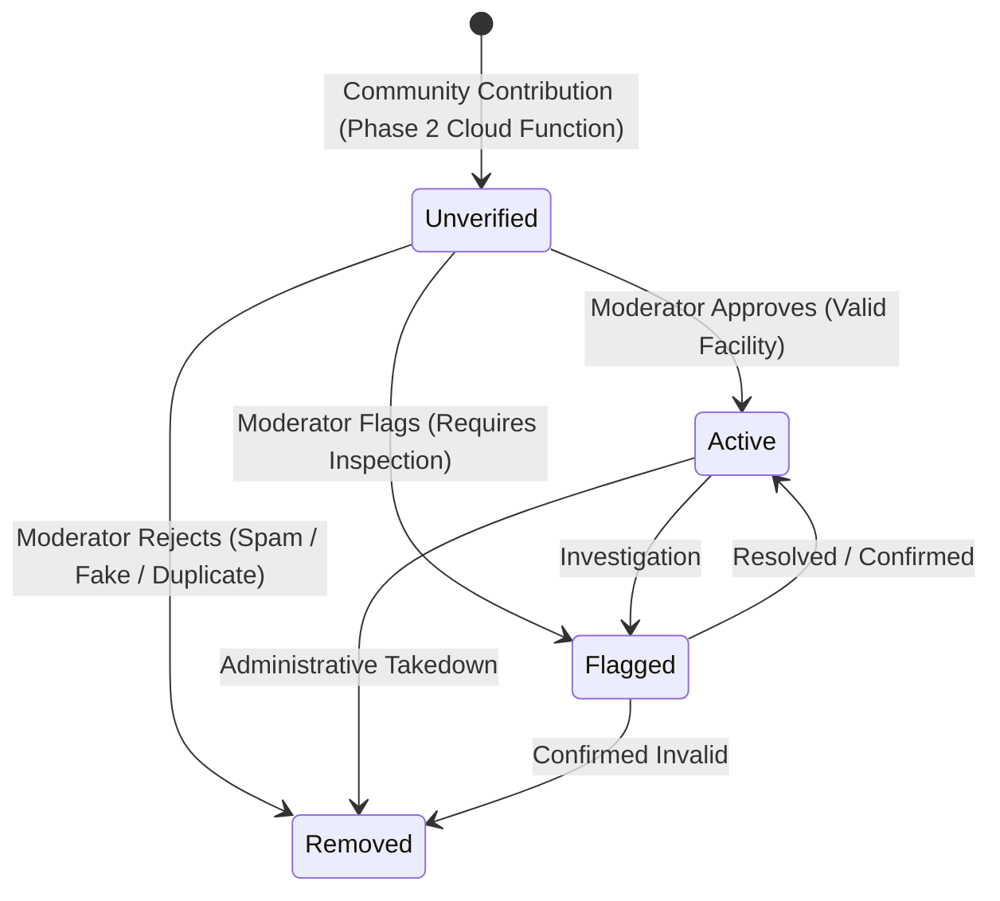

# P4.0 — Moderation & Facility Operations Specification

**Milestone:** Phase 4 / P4.0  
**Status:** SPECIFIED — READY FOR OWNER REVIEW  
**Development Sequence:** Phase 2 (P2.5 closeout + P2.6 gate) → **Phase 4 (Moderation)** → Phase 3 (Ratings/Reporting) → Phase 5  
**Parent Documentation:** `docs/01-architecture.md`, `docs/02-data-model.md`, `docs/03-privacy-security.md`

---

## 1. Authority & Strategic Intent

Read `AGENTS.md`, `docs/STATUS.md`, `docs/README.md`, `docs/02-data-model.md`, and `docs/03-privacy-security.md`.

### Strategic Justification for Accelerating Phase 4
Phase 2 opens community contributions of restrooms into Cloud Firestore as `status: 'unverified'`. Without operational moderation:
1. Contributed facilities accumulate in `unverified` state with no trusted path to `status: 'active'`.
2. Public maps risk clutter from low-quality, incomplete, or inaccurate submissions.
3. Introducing community ratings and user reports (Phase 3) on unmoderated facilities creates compounding data integrity risks.

Accelerating **Phase 4 (Moderation & Facility Operations)** directly after Phase 2 establishes a trusted administrative lifecycle for base restroom listings before enabling user ratings and reporting workflows.

### Bounded Scope:
- **IN SCOPE:** Operational moderation of community-contributed restrooms and their corresponding private contribution records.
- **EXPLICITLY DEFERRED (Phase 3):** User rating submissions, one-rating-per-UID ownership records, user verification events, and user report submission forms.

---

## 2. Privileged Service Boundary Architecture

### 2.1 Preserving Client Security Invariants
In `firestore.rules`, public restroom documents and private contributions are strictly protected from client manipulation:
```javascript
match /restrooms/{restroomId} {
  allow read: if true;
  // Direct client creation disabled in production per P2.6 server boundary
  allow create: if false; // Production release gate
  allow update: if false; // LOCKED INVARIANT
  allow delete: if false; // LOCKED INVARIANT
}

match /contributions/{contributionId} {
  allow read: if isAuthenticated() && resource.data.userUid == request.auth.uid;
  allow create: if false;        // Production release gate
  allow update, delete: if false; // LOCKED INVARIANT
}
```

**Mobile clients must NEVER be granted update or delete permissions in Security Rules.**

### 2.2 Privileged Backend Boundary (Cloud Functions V2)
All status transitions and moderation mutations execute exclusively through a **privileged server boundary** using the Firebase Admin SDK:
- **Callable Function V2:** `moderateRestroom`
- **Authentication & Authorization:** Enforced via Firebase Auth Custom Claims (`request.auth.token.admin === true` or `request.auth.token.moderator === true`).
- **Data Integrity:** Admin SDK bypasses client Security Rules, ensuring client rules remain strictly locked without opening update attack surfaces.

---

## 3. Privileged Administrator Identity Management & RBAC

### 3.1 Administrator Identity & MFA
1. **Dedicated Identity Provider:**
   - Administrative and moderator accounts **must NEVER use anonymous authentication**.
   - Admin accounts must use Firebase Auth Email/Password with strong credentials or Google Workspace SSO.
   - **Multi-Factor Authentication (MFA)** via SMS or TOTP authenticator apps is mandatory for all accounts carrying administrative claims.
2. **Role-Based Access Control (RBAC):**
   - **`moderator` (Least Privilege):** Can read the pending moderation queue and execute approve, reject, or flag transitions on restroom contributions. Cannot alter user claims, modify system settings, or delete audit logs.
   - **`admin` (Full Authority):** Can assign/revoke moderator claims, manage facility taxonomies, inspect complete audit logs, and trigger administrative takedowns.

### 3.2 Claims Issuance & Revocation Lifecycle
1. **Cryptographic Integrity:**
   - Firebase Auth custom claims (`admin`, `moderator`) are cryptographically signed by Google into the caller's JWT ID token.
   - Mobile clients and non-privileged users cannot issue, alter, or forge custom claims.
2. **Issuance Tooling (`tools/admin/set-claims.ts`):**
   - Custom claims are assigned strictly via a trusted server-side script using the Firebase Admin SDK authenticated via Google Cloud Service Account credentials with explicit IAM role restrictions.
   - Example issuance:
     ```typescript
     await admin.auth().setCustomUserClaims(targetUid, {
       moderator: true,
       assignedAt: Date.now(),
       assignedBy: adminUid,
     });
     ```
3. **Revocation & Token Refresh:**
   - When a moderator role is revoked, the administrative tool sets claims to `null` and invokes `admin.auth().revokeRefreshTokens(targetUid)` to invalidate existing sessions immediately.
   - The admin client application must listen to token changes or call `user.getIdToken(true)` to ensure active tokens reflect current claim state.

### 3.3 Audit-Log Tamper Protection
1. **Strict Append-Only Storage:**
   - Every moderation decision is recorded to `/moderationAuditLogs/{logId}`.
   - Client Firestore Security Rules enforce:
     ```javascript
     match /moderationAuditLogs/{logId} {
       allow read, write: if false; // Accessible ONLY via Firebase Admin SDK
     }
     ```
2. **Immutability:**
   - Audit logs are written strictly via the Firebase Admin SDK with server timestamps (`admin.firestore.FieldValue.serverTimestamp()`).
   - Neither regular users nor moderators can mutate, overwrite, or delete audit logs once written.

---

## 4. Restroom Moderation Lifecycle & State Machine



### 4.1 State Transitions
When an authorized moderator acts on a contribution, the server boundary executes an atomic batch update:

1. **Public Restroom Record (`/restrooms/{restroomId}`):**
   - Approve: `status = 'active'`, `updatedAt = serverTimestamp()`
   - Reject: `status = 'removed'`, `updatedAt = serverTimestamp()`
   - Flag: `status = 'flagged'`, `updatedAt = serverTimestamp()`
2. **Private Contribution Record (`/contributions/restroom_{restroomId}`):**
   - Approve: `moderationState = 'approved'`, `updatedAt = serverTimestamp()`, `moderatedAt = serverTimestamp()`, `moderatorUid = request.auth.uid`
   - Reject: `moderationState = 'rejected'`, `updatedAt = serverTimestamp()`, `moderatedAt = serverTimestamp()`, `moderatorUid = request.auth.uid`
   - Flag: `moderationState = 'flagged'`, `updatedAt = serverTimestamp()`
3. **Immutable Audit Log (`/moderationAuditLogs/{logId}`):**
   - Automatically generated document recording the transition.

### 4.2 Audit Log Schema (`/moderationAuditLogs/{logId}`)
```typescript
interface ModerationAuditLog {
  id: string;                      // Auto-generated log ID
  resourceType: 'restroom';        // Target entity type
  resourceId: string;              // restroomId
  contributionId: string;          // 'restroom_' + restroomId
  moderatorUid: string;            // Admin/Moderator Firebase UID
  moderatorRole: 'admin' | 'moderator';
  action: 'approve' | 'reject' | 'flag';
  previousRestroomStatus: string;  // e.g. 'unverified'
  newRestroomStatus: string;       // e.g. 'active'
  previousModerationState: string; // e.g. 'pending'
  newModerationState: string;      // e.g. 'approved'
  reasonNote?: string;             // Optional notes from moderator
  timestamp: FirebaseFirestore.Timestamp;
}
```

---

## 5. Implementation Contracts (Cloud Functions V2)

### 5.1 `moderateRestroom` Callable Function V2 Signature
```typescript
import { onCall, HttpsError, CallableRequest } from 'firebase-functions/v2/https';
import * as admin from 'firebase-admin';

export interface ModerateRestroomPayload {
  restroomId: string;
  action: 'approve' | 'reject' | 'flag';
  reasonNote?: string;
}

export const moderateRestroom = onCall(
  async (request: CallableRequest<ModerateRestroomPayload>) => {
    // 1. Authenticate caller
    if (!request.auth || !request.auth.uid) {
      throw new HttpsError('unauthenticated', 'Administrator authentication required.');
    }

    // 2. Authorize via Custom Claims
    const token = request.auth.token;
    const isAdmin = token.admin === true;
    const isModerator = token.moderator === true;
    if (!isAdmin && !isModerator) {
      throw new HttpsError('permission-denied', 'Privileged moderation authority required.');
    }
    const moderatorRole = isAdmin ? 'admin' : 'moderator';

    // 3. Validate Payload
    const { restroomId, action, reasonNote } = request.data;
    if (!restroomId || !['approve', 'reject', 'flag'].includes(action)) {
      throw new HttpsError('invalid-argument', 'Invalid moderation action or restroom ID.');
    }

    const db = admin.firestore();
    const now = admin.firestore.FieldValue.serverTimestamp();

    // 4. Atomic Transaction Execution
    return await db.runTransaction(async (transaction) => {
      const publicRef = db.collection('restrooms').doc(restroomId);
      const privateRef = db.collection('contributions').doc(`restroom_${restroomId}`);

      const publicSnap = await transaction.get(publicRef);
      if (!publicSnap.exists) {
        throw new HttpsError('not-found', 'Restroom document not found.');
      }
      const privateSnap = await transaction.get(privateRef);
      if (!privateSnap.exists) {
        throw new HttpsError('not-found', 'Matching contribution document not found.');
      }

      const prevRestroomStatus = publicSnap.data()?.status || 'unknown';
      const prevModerationState = privateSnap.data()?.moderationState || 'unknown';

      let newStatus: string;
      let newModState: string;
      if (action === 'approve') {
        newStatus = 'active';
        newModState = 'approved';
      } else if (action === 'reject') {
        newStatus = 'removed';
        newModState = 'rejected';
      } else {
        newStatus = 'flagged';
        newModState = 'flagged';
      }

      // Update public restroom
      transaction.update(publicRef, {
        status: newStatus,
        updatedAt: now,
      });

      // Update private contribution
      transaction.update(privateRef, {
        moderationState: newModState,
        moderatedAt: now,
        moderatorUid: request.auth.uid,
        updatedAt: now,
      });

      // Append immutable audit log
      const auditLogRef = db.collection('moderationAuditLogs').doc();
      transaction.set(auditLogRef, {
        id: auditLogRef.id,
        resourceType: 'restroom',
        resourceId: restroomId,
        contributionId: `restroom_${restroomId}`,
        moderatorUid: request.auth.uid,
        moderatorRole,
        action,
        previousRestroomStatus: prevRestroomStatus,
        newRestroomStatus: newStatus,
        previousModerationState: prevModerationState,
        newModerationState: newModState,
        reasonNote: reasonNote?.trim() || null,
        timestamp: now,
      });

      return { success: true, newStatus, newModerationState: newModState };
    });
  }
);
```

### 5.2 Milestone Breakdown for Phase 4
```text
P4.0 Specification & Architecture (This Document)
  ↓
P4.1 Privileged Backend Boundary & State Transition Engine
  ↓
P4.2 Moderation Queue & Review Interface (CLI / Web)
  ↓
P4.3 Audit Logging, Operational Telemetry & Safety Hardening
```

- **P4.1: Privileged Backend Boundary & State Transition Engine**
  - Implement `moderateRestroom` Cloud Function in `functions/src/moderation.ts`.
  - Add emulator test suite validating claims, transitions, and public UID non-leakage.
- **P4.2: Moderation Queue & Review Tooling**
  - Implement `getPendingModerationQueue` querying pending contributions joined with restroom details.
  - Deliver CLI tooling in `tools/moderation-cli.ts` (or lightweight web console) for rapid operator review.
- **P4.3: Operational Telemetry & Safety Hardening**
  - Implement moderation throughput monitoring and queue depth tracking.
  - Author automated security regression tests verifying audit trail completeness.

---

## 6. Definition of Done for Phase 4

Phase 4 is complete when:
1. Authorized moderators with verified MFA and custom claims can review pending restroom contributions.
2. Status transitions (`unverified` → `active` / `removed`) execute atomically via privileged Cloud Functions V2 code.
3. Client Firestore rules remain strictly create-only (`allow update, delete: if false;`).
4. Every moderation action is recorded in immutable `/moderationAuditLogs/` documents.
5. Automated emulator tests verify all security boundaries, role checks, and data invariants.
6. The human owner approves the completed moderation subsystem.
